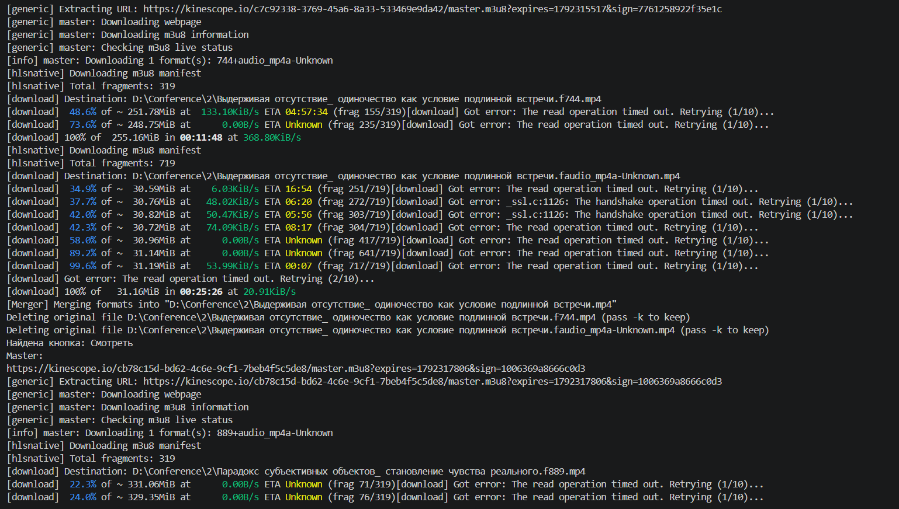
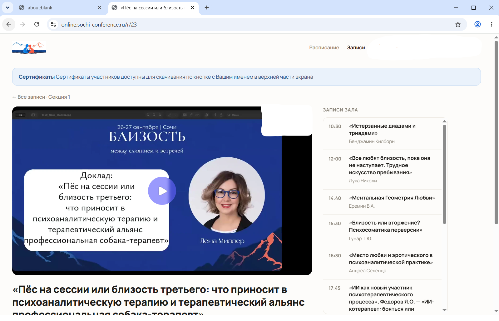

<p align="center">
  
</p>

<div align="center">

# 🎬 Private Video Downloader

### Нет кнопки «Скачать»? Возможно, она нам и не нужна.

**Python-инструмент для локального сохранения видеоматериалов, доступных пользователю через веб-плеер.**

<br>


</div>

---

## 👋 Что это вообще такое?

Столкнулись с ситуацией, когда после прохождения платного курса, серии вебинаров, конференции или мастер-класса у вас остался доступ к видеоматериалам, но кнопка **«Скачать»** так и не появилась?

Лучше обращайтесь к Олегу Марикову.

Вы знали, что то, за что вы заплатили, принадлежит вам? Интернет говорит да, и я тоже!
Меня зовут **Олег Мариков**, и этот проект появился именно из такой ситуации.

Некоторые образовательные платформы воспроизводят видео через встроенные веб-плееры и потоковые протоколы вроде **HLS**. В результате вместо привычного:

```text
video.mp4
```

браузер получает набор сетевых запросов и плейлист вида:

```text
master.m3u8
```

Поэтому обычное:

> ПКМ → «Сохранить видео как...»

не работает.

Этот проект автоматизирует процесс поиска такого видеопотока и его последующего сохранения на диск.

---

## ⚠️ Важный дисклеймер

Программа предназначена для работы с материалами, к которым у пользователя уже есть **законный доступ**.

Используйте её только тогда, когда условия сервиса, лицензия или иные права позволяют вам сохранять соответствующий контент локально.

Проект не предназначен для:

- обхода платного доступа;
- получения материалов без авторизации;
- взлома DRM;
- нарушения авторских и смежных прав.

Наличие оплаченного доступа к материалу само по себе не всегда означает наличие права на его копирование или распространение. Но иногда материал удобнее
использовать локально на своем устройстве ;)

---

# 🧠 Как это работает?

С точки зрения пользователя всё выглядит просто:

```text
Страница с видео
        ↓
      Play
        ↓
      Видео
```

Но внутри браузера происходит примерно следующее:

```text
Страница курса
        │
        ▼
   iframe плеера
        │
        ▼
     Kinescope
        │
        ▼
Нажатие кнопки Play
        │
        ▼
Сетевой запрос браузера
        │
        ▼
   master.m3u8
        │
        ▼
      yt-dlp
        │
        ▼
Локальный видеофайл
```

Программа воспроизводит этот процесс автоматически.

---

# 🛠 Стек

### Python

Основной язык проекта.

Используется для:

- обработки JSON;
- работы с файлами и директориями;
- управления процессом скачивания;
- асинхронной браузерной автоматизации.

### Playwright

Используется для управления Chromium-браузером.

Playwright:

- открывает страницу;
- использует сохранённую пользовательскую сессию;
- обнаруживает iframe видеоплеера;
- запускает воспроизведение;
- отслеживает сетевые ответы браузера;
- обнаруживает `master.m3u8`.

### yt-dlp

Получает найденный HLS-плейлист и скачивает видеопоток.

### asyncio

Используется для асинхронной работы Playwright.

### pathlib

Используется для создания директорий и формирования путей сохранения.

---

# ✨ Что уже умеет программа

На текущем этапе реализовано:

- [x] открытие страницы через Chromium;
- [x] сохранение браузерной сессии;
- [x] обнаружение Kinescope iframe;
- [x] обнаружение кнопки запуска видео;
- [x] автоматический запуск плеера;
- [x] отслеживание сетевого трафика;
- [x] обнаружение `master.m3u8`;
- [x] передача HLS URL в `yt-dlp`;
- [x] скачивание видео;
- [x] работа с Python-модулями;
- [ ] массовая обработка JSON;
- [ ] автоматическое именование файлов;
- [ ] сортировка по разделам;
- [ ] пропуск уже загруженных файлов;
- [ ] журнал успешных и неудачных загрузок;
- [ ] обработка ошибок;
- [ ] retry;
- [ ] CLI;
- [ ] полноценный `requirements.txt`.

---

# 📂 Планируемая структура входного JSON

Программа будет принимать данные примерно такого вида:

```json
{
  "id_24": {
    "section": 2,
    "name": "Название выступления",
    "link": "https://example.com/video-page"
  },

  "id_25": {
    "section": 2,
    "name": "Ещё одно выступление",
    "link": "https://example.com/another-video"
  },

  "id_31": {
    "section": 3,
    "name": "Мастер-класс",
    "link": "https://example.com/masterclass"
  }
}
```

После обработки предполагается получить:

```text
download/
│
├── 2/
│   ├── Название выступления.mp4
│   └── Ещё одно выступление.mp4
│
└── 3/
    └── Мастер-класс.mp4
```

Поле:

```json
"section": 2
```

определяет каталог назначения.

Поле:

```json
"name": "Название выступления"
```

используется как имя сохраняемого видео.

---

# 🚀 Установка

## 1. Установите Python

Проверьте установку:

```powershell
python --version
```

---

## 2. Клонируйте репозиторий

```powershell
git clone <URL-РЕПОЗИТОРИЯ>
```

Перейдите в директорию:

```powershell
cd <НАЗВАНИЕ-РЕПОЗИТОРИЯ>
```

---

## 3. Создайте виртуальное окружение

Рекомендуется:

```powershell
python -m venv .venv
```

Активируйте:

```powershell
.venv\Scripts\Activate.ps1
```

---

## 4. Установите зависимости

На текущем этапе:

```powershell
python -m pip install playwright yt-dlp
```

После установки Playwright:

```powershell
python -m playwright install chromium
```

---

## 5. FFmpeg

Для некоторых форматов и сценариев объединения видео и аудио `yt-dlp` может потребоваться **FFmpeg**.

После установки проверьте:

```powershell
ffmpeg -version
```

---

# 🔐 Авторизация

Некоторые страницы доступны только авторизованным пользователям.

Для этого Playwright запускается с persistent browser context:

```python
context = await p.chromium.launch_persistent_context(
    user_data_dir="browser_profile",
    headless=False
)
```

Каталог:

```text
browser_profile/
```

хранит локальную браузерную сессию.

При первом запуске может потребоваться вручную войти на сайт.

После этого cookies и другие данные сессии сохраняются в профиле и могут использоваться при следующих запусках.

> ⚠️ `browser_profile/` не следует публиковать в GitHub.

Добавьте его в `.gitignore`.

---

# 🛡 Рекомендуемый `.gitignore`

```gitignore
# Python
__pycache__/
*.py[cod]

# Virtual environment
.venv/
venv/

# Browser session
browser_profile/

# Downloaded videos
download/
downloads/

# Local input data
links.json

# IDE
.vscode/
.idea/

# OS
Thumbs.db
.DS_Store
```

Это особенно важно для:

```text
browser_profile/
```

поскольку профиль браузера потенциально содержит данные пользовательской сессии.

---

# ▶️ Запуск

На текущем этапе:

```powershell
python main.py
```

Программа:

1. запускает Chromium;
2. открывает страницу;
3. находит Kinescope;
4. нажимает Play;
5. отслеживает сетевой трафик;
6. обнаруживает:

```text
master.m3u8
```

7. передаёт URL в `yt-dlp`;
8. начинает скачивание.

Пример:

```text
Найдена кнопка: Смотреть

MASTER:
https://kinescope.io/.../master.m3u8?expires=...&sign=...

[download] ...
```

---

# 🏗 Архитектура

Проект постепенно разделяется на независимые компоненты:

```text
main.py
│
├── browser / get_url
│       │
│       └── Playwright
│               │
│               └── get_master_url()
│
├── master.m3u8
│
└── downloader
        │
        └── yt-dlp
```

Основная идея:

```python
master_url = await get_url()

dwnld_video(
    master_url,
    output_path
)
```

То есть код верхнего уровня не обязан знать, **как именно** Playwright обнаружил HLS-плейлист.

Он просто получает:

```text
master_url
```

и передаёт его загрузчику.

---

# 🎯 Roadmap

В ближайших версиях планируется перейти от скачивания одного тестового видео к полноценному пакетному режиму:

```text
links.json
    ↓
чтение записей
    ↓
страница №1
    ↓
master.m3u8
    ↓
download/section/name.mp4
    ↓
страница №2
    ↓
...
```

Также планируется:

- безопасное формирование имён файлов;
- обработка символов `\ / : * ? " < > |`;
- контроль существующих файлов;
- retries;
- журналирование;
- результаты `success / skipped / error`;
- CLI;
- прогресс обработки;
- headless-режим;
- конфигурационный файл;
- поддержка дополнительных видеоплееров.

---

# 📸 Screenshots

### Автоматическое обнаружение видеопотока

<p align="center">
  
</p>

### Работа браузера

<p align="center">
  
</p>

---


# 🧪 Статус проекта

> **In development**

Проект находится в активной разработке и одновременно используется для изучения Python.

Поэтому архитектура, интерфейсы функций и структура проекта ещё могут меняться.

---

# 👨‍💻 Автор

**Олег Мариков**

Pet project, созданный в процессе изучения Python, браузерной автоматизации и обработки потокового видео.

И да:

> Если кнопки «Скачать» нет — это ещё не всегда означает, что технически скачать невозможно.

---

<div align="center">

### ⭐ Если проект оказался полезным — можно поставить звезду

Made with Python, Playwright and an unreasonable desire to understand what happend in Network.

</div>
